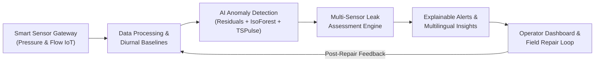

# 🌊 AquaSentinel AI
### AI-Powered Municipal Pipeline Leak Detection & Water Loss Sentinel
**Hackathon:** Sociothon'26 | **Problem Statement 7:** Intelligent Water Management  
**UN Sustainable Development Goals:** SDG 6 (Clean Water & Sanitation) • SDG 11 (Sustainable Cities) • SDG 12 (Responsible Consumption)  
**Team Name:** Social Spark (COEP Technological University, Pune)  
**Team Members:** Yash Nachan, Smaran Sable, Tilak Thete, Abhay Kumbhar  

---

## 📌 Executive Summary

Government pipeline networks span vast municipal areas with sparse physical measurement points. Conventional water distribution networks suffer from undetected subsurface leaks, joint blowouts, and bursts that go unnoticed for days or weeks until citizen grievances or visible road cave-ins occur—resulting in 30% to 50% non-revenue water (NRW) loss, colossal revenue drains, and energy wastage.

**AquaSentinel AI** is an intelligent pipeline monitoring platform that analyzes high-frequency pressure and flow dynamics in real time. By fusing diurnal hydraulic baselines, machine learning anomaly detection, multi-sensor spatial correlation, and explainable multilingual operator alerts, AquaSentinel AI detects and pinpoints leaks within seconds of onset, distinguishing localized bursts from upstream supply throttling.

---

## 🏗️ Architectural Blueprint

AquaSentinel AI follows an end-to-end 5-stage pipeline as outlined in our project design:



### 1. Smart Sensor Telemetry & Ingestion
- Collects continuous SCADA/IoT hydraulic telemetry: Inlet pressure ($P_{in}$), Outlet pressure ($P_{out}$), and Section Flow ($Q$).
- Synthetic telemetry generator modeled after the **BattLeDIM** (Battle of the Leakage Detection and Mitigation) benchmark dataset.
- Supports batch CSV upload for municipal historical benchmarking and stress testing.

### 2. Data Processing & Dynamic Hydraulic Baselines
- Tracks 24-hour diurnal urban consumption cycles with peak morning (07:00–10:00) and evening (18:00–21:00) water demand profiles.
- Accounts for static pipe elevation head loss and Hazen-Williams friction gradients.
- Calculates dynamic tolerance bounds ($\mu \pm 2.5\sigma$) adaptive to zone-specific network topology.

### 3. AI-Based Anomaly Detection
- **Statistical Residual Engine:** Computes running Z-scores and cumulative sum (CUSUM) deviations for sudden pressure collapse.
- **Multivariate Isolation Forest:** Detects non-linear, multi-dimensional correlations ($[P_{dev}, Q_{dev}, \Delta P/\Delta t, \Delta Q/\Delta t]$).
- **IBM Granite TSPulse & TTM Adapter:** Pluggable connector for foundation time-series anomaly detection and demand forecasting.

### 4. Multi-Sensor Spatial Leak Assessment
- **Localized Pipe Rupture:** Sharp pressure drop accompanied by an inlet flow surge ($-\Delta P \text{ and } +\Delta Q$).
- **Broader Supply Interruption:** Synchronous drop in pressure and flow ($-\Delta P \text{ and } -\Delta Q$, e.g., upstream booster pump trip).
- **Sensor Drift / Fault:** Uncorrelated single-sensor variation with zero adjacent node gradient.
- Computes estimated water loss rate ($m^3/\text{hour}$) and prioritizes incident severity (`LOW`, `MEDIUM`, `HIGH`, `CRITICAL`).

### 5. Explainable Multilingual Alerts & Repair Tracking
- Generates natural-language root-cause rationales for operators and field crews.
- Multilingual alerts in **English**, **Hindi (हिंदी)**, and **Marathi (मराठी)** for on-ground municipal workers.
- End-to-end feedback loop: Assign technicians -> record repair findings -> verify post-repair pressure restoration -> auto-resolve alert.

---

## 💻 Mandatory IBM Tech Stack Integration

| IBM Technology | Role in AquaSentinel AI |
| :--- | :--- |
| **watsonx.ai Studio** | Model development, historical training, and notebook workflows (`notebooks/watsonx_anomaly_detection.ipynb`). |
| **IBM Granite Time Series (TTM & TSPulse)** | Zero-shot / few-shot time-series forecasting and high-frequency anomaly scoring adapter (`backend/app/services/ibm_adapter.py`). |
| **IBM Event Streams (Kafka)** | Real-time high-throughput telemetry ingestion from municipal flow and pressure sensors. |
| **IBM Cloud Object Storage & Cloudant** | Durable persistence of sensor time-series histories, incident audit logs, and inspection verification tasks. |
| **IBM Code Engine** | Containerized serverless hosting for backend REST APIs and the interactive frontend dashboard (`Dockerfile`). |
| **watsonx Assistant** | Conversational operator interface delivering incident summaries and field dispatches in local languages. |
| **IBM Bob** | AI-assisted development partner used for architecture planning, code scaffolding, test case creation, and validation. |

---

## 📂 Project Structure

The repository is modularly decoupled into independent backend, frontend, data, and testing modules for maintainability:

```
aquasentinel-ai/
├── backend/                        # FastAPI REST API & Core Intelligence
│   ├── app/
│   │   ├── main.py                 # Application entrypoint & static mounts
│   │   ├── models/
│   │   │   └── schemas.py          # Pydantic telemetry, alert & repair schemas
│   │   ├── routes/
│   │   │   ├── sensors.py          # Real-time sensor endpoints
│   │   │   ├── network.py          # Topological pipeline network data
│   │   │   ├── detection.py        # Detection cycle trigger & anomaly queries
│   │   │   ├── alerts.py           # Alert management & multilingual queries
│   │   │   ├── repairs.py          # Field technician dispatch & repair loop
│   │   │   ├── simulate.py         # Live leak injection controls
│   │   │   └── upload.py           # CSV benchmark dataset ingestion
│   │   ├── services/
│   │   │   ├── baseline.py         # 24h diurnal hydraulic baseline engine
│   │   │   ├── detector.py         # Residual & Isolation Forest detector
│   │   │   ├── assessment.py       # Multi-sensor spatial leak classifier
│   │   │   ├── explainable.py      # Multilingual explanation generator
│   │   │   └── ibm_adapter.py      # IBM watsonx / Granite integration adapter
│   │   └── storage/
│   │       └── db.py               # Thread-safe in-memory/SQLite store
│   └── requirements.txt            # Backend specific dependencies
│
├── frontend/                       # Interactive Dashboards
│   ├── templates/
│   │   └── index.html              # Modern Operator Web Dashboard
│   ├── static/
│   │   ├── css/style.css           # High-contrast, dark-mode accessible CSS
│   │   └── js/app.js               # Live polling, Chart.js graphs, SVG pipeline map
│   ├── streamlit_app.py            # Streamlit Advanced Analytics & Diagnostic Console
│   └── requirements.txt            # Frontend dependencies
│
├── data/                           # Datasets & Benchmarks
│   ├── battledim_benchmark_sample.csv  # BattLeDIM real-world benchmark data
│   ├── sample_normal_telemetry.csv     # Clean diurnal telemetry profile
│   └── sample_leak_incident.csv        # Simulated pipe rupture incident
│
├── notebooks/                      # Watsonx Research & Prototyping
│   └── watsonx_anomaly_detection.ipynb # Granite TSPulse & baseline model notebook
│
├── simulator/                      # SCADA / IoT Network Simulator
│   └── network_sim.py              # Hydraulic loop with leak injection
│
├── tests/                          # Automated Pytest Suite
│   ├── test_api.py                 # Endpoints & repair feedback loop tests
│   ├── test_detection.py           # Baseline & leak classification tests
│   └── test_simulator.py           # Simulator & leak injection verification
│
├── Dockerfile                      # Containerization for IBM Code Engine
├── requirements.txt                # Unified root Python dependencies
├── .env.example                    # Environment variable template
└── README.md                       # Comprehensive project documentation
```

---

## 🚀 Quickstart & Setup Guide

### 1. Prerequisites
- Python 3.10+ (Tested on Python 3.11, 3.12, 3.14)
- Git

### 2. Clone Repository & Setup Virtual Environment
```bash
git clone -b Abhay_NSS https://github.com/askumbhar501/aquasentinel-ai.git
cd aquasentinel-ai

python -m venv .venv

# On Windows:
.venv\Scripts\activate
# On Linux/macOS:
source .venv/bin/activate

pip install -r requirements.txt
```

### 3. Configure Environment Variables
```bash
cp .env.example .env
# Edit .env with your IBM watsonx / Cloudant credentials if connecting to live IBM cloud services
```

### 4. Run the Operator Web Dashboard (FastAPI)
```bash
python -m uvicorn backend.app.main:app --reload --port 8000
```
Open your browser and navigate to:
- **Interactive Operator Dashboard:** `http://localhost:8000`
- **Swagger Interactive API Docs:** `http://localhost:8000/docs`
- **OpenAPI JSON Specification:** `http://localhost:8000/openapi.json`

### 5. (Alternative) Run the Streamlit Analytics Console
```bash
streamlit run frontend/streamlit_app.py
```
Access the Streamlit console at `http://localhost:8501` to view dual-axis hydraulic trends, inspect diurnal bounds, and simulate real-time leak injections.

---

## 🧪 Automated Testing

Execute the test suite verifying mathematical baselines, multi-sensor leak classification, and end-to-end technician repair feedback loops:

```bash
python -m pytest -v tests
```

Output:
```text
============================= test session starts =============================
collected 12 items

tests/test_api.py::test_get_network_topology PASSED                      [  8%]
tests/test_api.py::test_get_sensors_summary PASSED                       [ 16%]
tests/test_api.py::test_trigger_detection_cycle PASSED                   [ 25%]
tests/test_api.py::test_get_alerts PASSED                                [ 33%]
tests/test_api.py::test_inspection_repair_feedback_loop PASSED           [ 41%]
tests/test_detection.py::test_baseline_engine_diurnal_bounds PASSED      [ 50%]
tests/test_detection.py::test_anomaly_detector_normal_readings PASSED    [ 58%]
tests/test_detection.py::test_anomaly_detector_detects_severe_pressure_drop PASSED [ 66%]
tests/test_detection.py::test_multi_sensor_leak_classification PASSED    [ 75%]
tests/test_detection.py::test_multi_sensor_supply_interruption_classification PASSED [ 83%]
tests/test_simulator.py::test_simulator_generates_readings PASSED        [ 91%]
tests/test_simulator.py::test_simulator_leak_injection PASSED            [100%]

============================= 12 passed in 5.75s ==============================
```

---

## 🌐 Key API Endpoints

| Method | Endpoint | Description |
| :--- | :--- | :--- |
| `GET` | `/` | Serves the interactive Operator Web Dashboard |
| `GET` | `/api/health` | Service health status & metadata |
| `GET` | `/api/network/topology` | Complete municipal pipeline topology, sections, and nodes |
| `GET` | `/api/sensors/summary` | Real-time pressure, flow, and status across all sections |
| `POST` | `/api/detection/run` | Triggers immediate multi-sensor AI detection cycle |
| `GET` | `/api/alerts/` | Lists active and historical leak alerts with risk scores |
| `POST` | `/api/repairs/assign` | Dispatches technician to inspect flagged pipeline section |
| `POST` | `/api/repairs/tasks/{id}/complete` | Records repair findings and closes the feedback loop |
| `POST` | `/api/simulate/leak` | Injects synthetic leak incident for live demo verification |
| `POST` | `/api/upload/csv` | Ingests BattLeDIM or SCADA telemetry CSV for analysis |

---

## 👥 Team Social Spark
- **Yash Nachan** (CSE / TY) – `yashnachan1015@gmail.com`
- **Smaran Sable** (Metallurgy / TY) – `s97sable@gmail.com`
- **Tilak Thete** (CSE / SY) – `tilakthete07@gmail.com`
- **Abhay Kumbhar** (CSE / SY) – `askumbhar501@gmail.com`  
*College:* COEP Technological University, Pune
